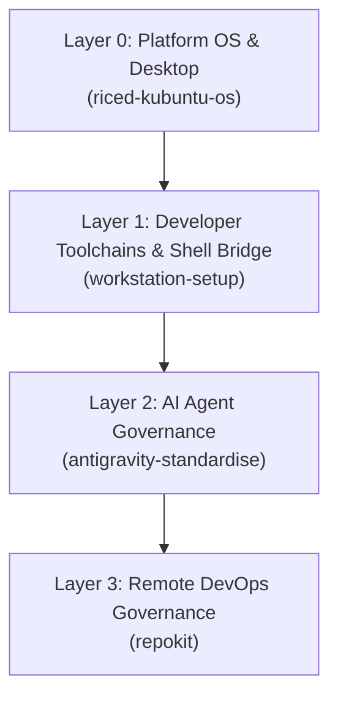

# workstation-setup

[](LICENSE)
[](https://conventionalcommits.org)
[](https://python.org)

A cross-platform developer toolchain manager, shell environment bridge, and meta-orchestrator across Linux, macOS, and Windows.

---

## The Philosophy

Modern development environments require coordinating operating system packages, developer language runtimes, AI coding agent permissions, and GitHub DevOps standards. When configuring a new machine or synchronizing existing workstations, manually provisioning tools and updating shell startup files introduces configuration drift, duplicate environment blocks, and inconsistent paths.

`workstation-setup` solves this by providing:
1. **Declarative Cross-Platform Toolchains**: Tiered catalog (`minimal`, `dev`, `full`) defining installation and companion binaries across Linux, macOS, and Windows.
2. **Idempotent Shell Environment Bridge**: Injects and maintains standard environment blocks in `~/.bashrc` and `~/.profile` without duplication.
3. **4-Layer Meta-Orchestrator**: Unifies OS setup, developer runtimes, AI pair programmer standards, and GitHub repository governance under a single CLI.

---

## Workstation Ecosystem Architecture

`workstation-setup` operates as **Layer 1** in the 4-layer workstation configuration stack:



- **Layer 0 (`riced-kubuntu-os`)**: Kubuntu OS packages, KDE Plasma 6 desktop styling, audio/display configurations, and system dotfiles.
- **Layer 1 (`workstation-setup`)**: Cross-platform developer toolchains (`git`, `gh`, `uv`, `node`, `starship`, `zoxide`, `fzf`, `eza`), shell environment variable resolution, and local SQLite developer database initialization.
- **Layer 2 (`antigravity-standardise`)**: AI pair programmer harness permissions, global agent directives (`AGENTS.md`), MCP servers, and autonomous workflows.
- **Layer 3 (`repokit`)**: Remote GitHub repository rulesets, squash-and-merge enforcement, and semantic PR CI quality gates.

---

## Toolchain Profile Tiers

Toolchains are declaratively configured in `config/toolchains.json` with three cumulative profile tiers:

| Tier | Tools Included | Description |
| :--- | :--- | :--- |
| **`minimal`** | `git`, `gh` | Essential version control and GitHub access for lightweight environments or CI runners. |
| **`dev`** | `git`, `gh`, `uv` (`uvx`), `node` (`npm`, `npx`), `starship` | Standard developer environment including modern Python/JS runtimes and shell prompt. |
| **`full`** | All `dev` tools + `zoxide`, `fzf`, `eza` | Complete terminal productivity suite with modern shell replacements. |

---

## Shell Environment Bridge

The orchestrator idempotently injects the Antigravity Standards Environment block into `~/.bashrc` and `~/.profile`:

```bash
# >>> Antigravity Standards Environment >>>
# Dynamically resolve GitHub token from gh keyring if not already exported
if command -v gh >/dev/null 2>&1; then
    export GITHUB_PERSONAL_ACCESS_TOKEN="${GITHUB_PERSONAL_ACCESS_TOKEN:-$(gh auth token 2>/dev/null)}"
fi

# Default SQLite development database path for Antigravity SQLite MCP server
export SQLITE_DEV_DB="${SQLITE_DEV_DB:-$HOME/dev.db}"
# <<< Antigravity Standards Environment <<<
```

- **Keyring-backed Token Resolution**: Resolves `GITHUB_PERSONAL_ACCESS_TOKEN` dynamically via `gh auth token` without hardcoding plain-text secrets in shell configs.
- **SQLite MCP Server Database**: Automatically initializes `$HOME/dev.db` for the local Model Context Protocol SQLite server.
- **Full Idempotence**: Updates in place if the block exists, or cleanly appends if not present.

---

## Installation

Clone the repository and run the idempotent installer to symlink `workstation-setup` into `~/.local/bin`:

```bash
git clone https://github.com/Cooper-Wallace/workstation-setup.git ~/Projects/workstation-setup
cd ~/Projects/workstation-setup
./install.sh
```

To preview changes without touching the filesystem:
```bash
./install.sh --dry-run
```

---

## CLI Usage

### 1. Audit Workstation Configuration

Run an audit across all 4 layers for the desired profile tier:

```bash
# Audit standard developer profile
workstation-setup audit

# Audit full tier with verbose installation hints
workstation-setup audit --profile full --verbose

# Audit specific OS target
workstation-setup audit --os macos --profile dev
```

### 2. Apply Workstation Setup

Apply configuration across all stages or target specific layers:

```bash
# Preview what would be applied without modifying anything
workstation-setup apply --dry-run

# Apply developer profile across all stages
workstation-setup apply --profile dev

# Apply and automatically install missing toolchains
workstation-setup apply --profile dev --install-missing

# Target specific stages (0: OS, 1: Toolchains, 2: Shell, 3: Agent, 4: DevOps)
workstation-setup apply --stage 2
```

### 3. Standalone Subcommands

```bash
# Standalone shell environment injection
workstation-setup env [--bashrc-path PATH] [--dry-run]

# Standalone toolchain audit and installation
workstation-setup toolchains [--profile minimal|dev|full] [--install] [--dry-run]
```

---

## Verification & Testing

Run the automated test suite using Python's standard `unittest`:

```bash
python3 -m unittest discover tests -v
```

All tests run hermetically using temporary directories and mock configurations without mutating the host environment.

---

## License

MIT License. Copyright (c) 2026 Cooper Wallace.
