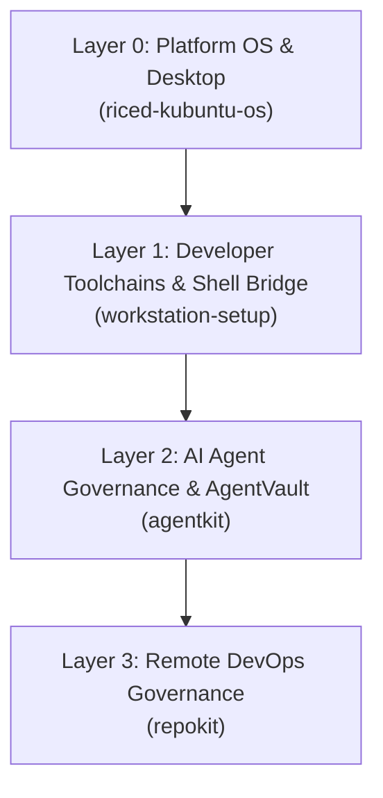

# workstation-setup

[](LICENSE)
[](https://conventionalcommits.org)
[](https://go.dev)

A fast, statically compiled cross-platform developer toolchain manager, shell environment bridge, and meta-orchestrator across Linux, macOS, and Windows.

---

## The Philosophy

Modern development environments require coordinating operating system packages, developer language runtimes, AI coding agent permissions, and GitHub DevOps standards. When configuring a new machine or synchronizing existing workstations, manually provisioning tools and updating shell startup files introduces configuration drift, duplicate environment blocks, and inconsistent paths.

`workstation-setup` solves this by providing:
1. **Declarative Cross-Platform Toolchains**: Tiered 15-tool catalog (`minimal`, `dev`, `full`) embedded directly in the static binary via `//go:embed config/toolchains.json`, defining installation instructions and companion binaries across Linux, macOS, and Windows.
2. **Idempotent Shell Environment Bridge**: Injects and maintains standard environment blocks in `~/.bashrc` and `~/.profile` without duplication, bridging keyring tokens and Obsidian AgentVault paths.
3. **4-Layer Meta-Orchestrator**: Unifies OS setup, developer runtimes, AI pair programmer standards, and GitHub repository governance under a single zero-dependency CLI.

---

## Workstation Ecosystem Architecture

`workstation-setup` operates as **Layer 1** in the 4-layer workstation configuration stack:



- **Layer 0 (`riced-kubuntu-os`)**: Kubuntu OS packages, KDE Plasma 6 desktop styling, audio/display configurations, and system dotfiles.
- **Layer 1 (`workstation-setup`)**: Statically compiled Go orchestrator, cross-platform developer toolchains (`git`, `gh`, `zram`, `uv`, `node`, `starship`, `go`, `docker`, `zoxide`, `fzf`, `eza`, `kubectl`, `k3s`, `helm`, `k9s`), shell environment variable resolution, and local SQLite developer database initialization.
- **Layer 2 (`agentkit`)**: AI pair programmer harness permissions, Git-backed Obsidian `AgentVault` (`$HOME/Documents/AgentVault`) provisioning and synchronization via `agentkit vault sync`, global agent directives (`AGENTS.md`), MCP servers, and autonomous workflows.
- **Layer 3 (`repokit`)**: Remote GitHub repository rulesets, squash-and-merge enforcement, and semantic PR CI quality gates.

---

## Toolchain Profile Tiers (15-Tool Catalog)

Toolchains are declaratively configured in `config/toolchains.json` with three cumulative profile tiers:

| Tool | Profile Tier | Category | Binary | Companion Binaries | Description |
| :--- | :--- | :--- | :--- | :--- | :--- |
| **Git** | `minimal` | `vcs` | `git` | — | Distributed version control system |
| **GitHub CLI** | `minimal` | `vcs` | `gh` | — | Official GitHub command-line interface |
| **ZRAM Compressed Swap** | `minimal` | `system` | `zramctl` | — | Kernel compressed in-RAM swap device to prevent out-of-memory lockups |
| **Astral uv** | `dev` | `python` | `uv` | `uvx` | Extremely fast Python package and project manager written in Rust |
| **Node.js** | `dev` | `javascript` | `node` | `npm`, `npx` | JavaScript runtime environment and Node ecosystem (via fnm or package manager) |
| **Starship Prompt** | `dev` | `prompt` | `starship` | — | Fast, customizable, cross-shell prompt |
| **Go Toolchain** | `dev` | `golang` | `go` | `gofmt` | Go programming language compiler, module manager, and runtime |
| **Docker Engine & CLI** | `dev` | `container` | `docker` | — | OCI container runtime and image build toolchain |
| **Zoxide** | `full` | `shell_enhancement` | `zoxide` | — | Smarter `cd` command inspired by z and autojump |
| **FZF** | `full` | `shell_enhancement` | `fzf` | — | General-purpose command-line fuzzy finder |
| **Eza** | `full` | `shell_enhancement` | `eza` | — | Modern, maintained replacement for `ls` |
| **Kubernetes CLI** | `full` | `kubernetes` | `kubectl` | — | Kubernetes cluster command-line control tool |
| **K3s Kubernetes** | `full` | `kubernetes` | `k3s` | — | Lightweight CNCF-certified Kubernetes distribution for homelab and edge |
| **Helm** | `full` | `kubernetes` | `helm` | — | Kubernetes package and chart manager |
| **K9s Terminal UI** | `full` | `kubernetes` | `k9s` | — | Terminal-based UI to interact with Kubernetes clusters |

### Tier Summary
- **`minimal`** (3 tools): Essential version control and system memory stability for lightweight environments, headless servers, or CI runners.
- **`dev`** (8 tools): Cumulative standard developer environment including modern Python, JS, Go runtimes, Docker containers, and shell prompt.
- **`full`** (15 tools): Complete workstation suite including modern terminal replacements, Kubernetes orchestration tools, and cluster management TUIs.

---

## Shell Environment Bridge

The orchestrator idempotently injects the Antigravity Standards Environment block into `~/.bashrc` and `~/.profile`:

```bash
# >>> Antigravity Standards Environment >>>
# Dynamically resolve GitHub token from gh keyring if not already exported
if command -v gh >/dev/null 2>&1; then
    export GITHUB_PERSONAL_ACCESS_TOKEN="${GITHUB_PERSONAL_ACCESS_TOKEN:-$(gh auth token 2>/dev/null)}"
fi

# Default SQLite development database path for Antigravity SQLite MCP server
export SQLITE_DEV_DB="${SQLITE_DEV_DB:-$HOME/dev.db}"

# Default Obsidian AgentVault path for cross-session agent memory and repokit exemptions
export AGENTKIT_AGENTVAULT_PATH="${AGENTKIT_AGENTVAULT_PATH:-$HOME/Documents/AgentVault}"
# <<< Antigravity Standards Environment <<<
```

- **Keyring-backed Token Resolution**: Resolves `GITHUB_PERSONAL_ACCESS_TOKEN` dynamically via `gh auth token` without hardcoding plain-text secrets in shell configs.
- **SQLite MCP Server Database**: Automatically initializes `$HOME/dev.db` for the local Model Context Protocol SQLite server.
- **Obsidian AgentVault Bridge**: Exports `AGENTKIT_AGENTVAULT_PATH` so `agentkit` and `repokit` share a consistent, git-backed vault path across workstations.
- **Full Idempotence**: Updates in place if the block exists, or cleanly appends if not present.

---

## Installation

### Option 1: Build and Install from Source (Recommended)

Compile the static Go binary directly into `~/.local/bin` using the automated installer:

```bash
git clone https://github.com/Cooper-Wallace/workstation-setup.git ~/Projects/workstation-setup
cd ~/Projects/workstation-setup
./install.sh
```

To preview installation actions without touching the filesystem:
```bash
./install.sh --dry-run
```

The installer installs:
- Primary executable: `~/.local/bin/workstation-setup`
- Command alias: `~/.local/bin/ws-setup`
- GitHub CLI extension link: `~/.local/bin/gh-workstation-setup`

### Option 2: Pre-compiled GitHub Releases

Download the pre-compiled binary for your architecture (`linux`, `darwin`, `windows` for `amd64` and `arm64`) from the [GitHub Releases](https://github.com/Cooper-Wallace/workstation-setup/releases) page:

```bash
# Example for Linux AMD64
tar -xzf workstation-setup_*_linux_amd64.tar.gz
chmod +x workstation-setup
mv workstation-setup ~/.local/bin/
```

### Option 3: GitHub CLI Extension

Install directly as a GitHub CLI extension:

```bash
gh extension install Cooper-Wallace/workstation-setup
```

---

## CLI Usage

### 1. Audit Workstation Configuration

Run an audit across all 4 layers for the desired profile tier:

```bash
# Audit standard developer profile
workstation-setup audit

# Audit full tier with verbose installation instructions
workstation-setup audit --profile full --verbose

# Audit specific OS target
workstation-setup audit --os macos --profile dev
```

### 2. Apply Workstation Setup

Apply configuration across all stages or target specific layers:

```bash
# Preview what would be applied without modifying anything
workstation-setup apply --dry-run

# Apply developer profile across all stages
workstation-setup apply --profile dev

# Apply and automatically install missing toolchains
workstation-setup apply --profile dev --install-missing

# Target specific stages (0: OS, 1: Toolchains, 2: Shell, 3: Agent, 4: DevOps)
workstation-setup apply --stage 2
workstation-setup apply --stage 3
```

- **Stage 3 (AI Agent Governance & AgentVault)**: Provisions and synchronizes the Git-backed Obsidian `AgentVault` (`$HOME/Documents/AgentVault`) with standard Obsidian workspace `.gitignore` rules, invokes `agentkit vault sync`, and enforces harness permissions via `agentkit apply`. Includes a guarded offline degrade path if remote cloning fails.

### 3. Standalone Subcommands

```bash
# Standalone shell environment injection
workstation-setup env [--bashrc-path PATH] [--dry-run]

# Standalone toolchain audit and installation
workstation-setup toolchains [--profile minimal|dev|full] [--install] [--dry-run]
```

All commands can also be run via the concise shorthand alias `ws-setup` or as `gh workstation-setup`.

---

## Example Workflow

Here is a typical end-to-end workflow when provisioning a new developer machine:

```bash
# 1. Install workstation-setup
git clone https://github.com/Cooper-Wallace/workstation-setup.git ~/Projects/workstation-setup
cd ~/Projects/workstation-setup
./install.sh

# 2. Audit current machine state against the 'dev' tier
ws-setup audit --profile dev

# 3. Preview planned configuration changes without touching state
ws-setup apply --profile dev --dry-run

# 4. Apply configuration and install any missing toolchains
ws-setup apply --profile dev --install-missing

# 5. Verify the installation and reload your shell environment
source ~/.bashrc
ws-setup audit --profile dev
```

---

## Configuration, Failure Modes & Safe Degrade Behavior

`workstation-setup` is engineered for resilient, non-destructive execution across heterogeneous developer environments:

- **Offline Degradation for AgentVault**: During Stage 3, if the remote Git repository for Obsidian AgentVault is unreachable (e.g. no internet connection or VPN restricted), `workstation-setup` gracefully degrades by initializing the local vault directory structure and `.gitignore` without failing the overall apply pipeline.
- **Graceful Toolchain Fallback**: If an OS package manager (`apt`, `brew`, `winget`, `snap`) is unavailable or lacks administrative privileges, the tool outputs clear manual installation commands rather than aborting abruptly.
- **Dynamic Keyring Resolution**: When evaluating `GITHUB_PERSONAL_ACCESS_TOKEN`, the shell bridge queries `gh auth token` dynamically. If GitHub CLI is unauthenticated, the environment variable is left unset rather than injecting an empty or broken value.
- **Hermetic Shell Block Replacement**: Injections into `~/.bashrc` and `~/.profile` strictly replace content between `# >>> Antigravity Standards Environment >>>` and `# <<< Antigravity Standards Environment <<<`. Any custom user configurations outside these delimiters remain completely untouched.
- **Kernel Swap Detection**: ZRAM swap configuration checks the Linux kernel `zram` module. On macOS and Windows, where compressed memory paging is handled natively by the kernel, `zram` checks are automatically bypassed with informational status.

---

## Known Limitations

- **Administrative Privileges**: Installing system packages (`apt`, `snap`, `systemctl`) requires `sudo` privileges. Non-privileged users should install developer runtimes via user-space managers (`fnm`, `uv`).
- **Windows Package Automation**: Windows package management relies on `winget`. On older Windows installations lacking Windows Package Manager, manual software installation is required.
- **ZRAM In-Memory Swap**: ZRAM swap tools (`zram-tools`, `zramctl`) are specific to Linux kernel environments.

---

## Verification & Testing

The test suite runs hermetically using Go 1.23+ standard library:

```bash
go test -v -race ./...
```

Tests verify toolchain catalog parsing, profile tier cumulative filtering, shell block injection idempotence, OS platform normalization, and dry-run execution using temporary directories (`t.TempDir()`).

---

## License

MIT License. Copyright (c) 2026 Cooper Wallace.
